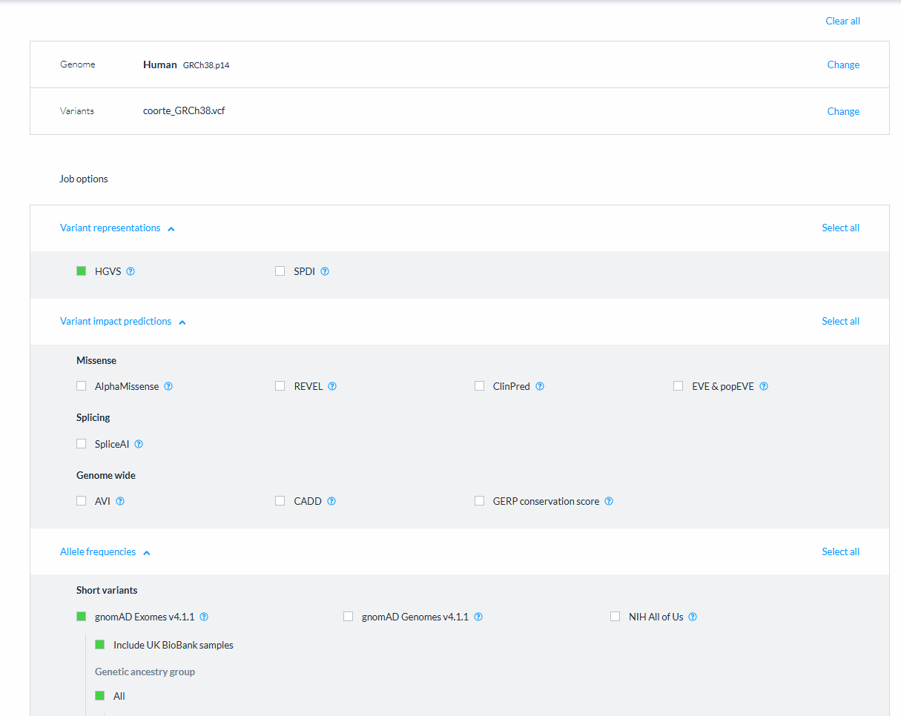

# Pipeline P04 e P06 – Passo a passo

08/11/2026

## Visão geral

Rodei o pipeline de variantes da aula (IEC – PUC Minas) só para os pacientes **P04** e **P06**. As etapas 1–7c e 9–10 estão prontas; a etapa 8 (VEP no site) foi enviada e aguarda o download do resultado.

- É uma cópia do repositório principal `aula-variantes-cancer`, feita em 05–06/11/2026. O repositório principal não foi alterado.
- Ferramentas no ambiente micromamba `aula-variantes`.
- Ajustes só nesta cópia: o merge junta apenas as amostras passadas como argumento, e o gráfico lollipop do TP53 é pulado se não houver variante rara no TP53.

## Etapas 1–7c: do FASTQ ao VCF da coorte

Um único comando roda as etapas 1 a 7c para os dois pacientes, a partir da pasta do projeto:

```bash
bash scripts/rodar_pipeline.sh P04 P06
```

1. **FastQC**: controle de qualidade das leituras.
2. **Trimmomatic**: remoção de adaptadores e bases de baixa qualidade.
3. **BWA**: alinhamento ao genoma de referência.
4. **SAMtools / Picard**: ordenação, índice e marcação de duplicatas.
5. **BCFtools**: chamada e filtragem de variantes.
6. **Coordenadas GRCh38**: conversão das posições para o genoma completo.
7. **Merge (7c)**: junta P04 e P06 em `resultados/08_para_o_VEP/coorte_GRCh38.vcf`.

| Métrica | P04 | P06 |
| --- | --- | --- |
| Pares mantidos | 86,2% | 86,0% |
| Duplicatas | 17,6% | 18,1% |
| Profundidade média | 67x | 66x |
| Variantes após filtro | 15 | 15 |

Resumo do QC em `resultados/resumo_qc.tsv`.

## Etapa 8: anotação no site do VEP

Enviei `coorte_GRCh38.vcf` ao VEP do Ensembl (nova interface), com o conjunto de transcritos GENCODE 50 e as frequências do gnomAD Exomes v4.1.1.

**1. Abrir a pasta pelo Windows (WSL)**

```bash
cd resultados/08_para_o_VEP && explorer.exe .
```

**2. Preencher o formulário**

1. Acessar https://www.ensembl.org/Tools/VEP e clicar em **Launch VEP**.
2. **Genome**: Human **GRCh38.p14**.
3. **Variants**: enviar o arquivo `coorte_GRCh38.vcf`.
4. Em **Job options → Variant representations**, marcar **HGVS** (SPDI desmarcado).
5. Em **Allele frequencies → Short variants**, marcar **gnomAD Exomes v4.1.1** (vem com *Include UK BioBank samples* e ancestralidade *All* marcados).
6. Deixar desmarcado todo o resto: Variant impact predictions (AlphaMissense, REVEL, CADD, SpliceAI…), gnomAD Genomes, Genes & transcripts, Protein & functional, Regulatory e Phenotype & disease associations.
7. Não marcar *Exclude common variants*.
8. Na barra superior, **Transcript set = GENCODE 50**; o nome da submissão pode ficar vazio.
9. Clicar em **Run** (1–5 min).

Opções usadas no envio:



**3. Baixar o resultado**

1. Quando o job aparecer como **Done**, clicar em **View results**.
2. Em **Download**, escolher **VCF** (não TXT nem formato VEP).
3. Renomear para `coorte_anotada_VEP.vcf`.
4. Mover para `resultados/08_para_o_VEP/`, substituindo o arquivo do Plano B.

A nova interface não mostrou uma opção de “uma consequência por variante”. Isso será conferido no arquivo baixado.

## Etapas 9–10: MAF e maftools

Já rodaram com a anotação do Plano B. Serão rodadas de novo com o arquivo do VEP:

```bash
bash scripts/vcf_para_maf.sh resultados/08_para_o_VEP/coorte_anotada_VEP.vcf resultados/09_maf/coorte.maf
Rscript scripts/analise_maftools.R resultados/09_maf/coorte.maf
```

- **Etapa 9** gera o MAF em `resultados/09_maf/coorte.maf`. Se aparecer “não tem a anotação CSQ”, o download não foi no formato VCF.
- **Etapa 10** gera as figuras em `resultados/10_maftools/` (01 a 07).

Conferência:

- `cut -f15 resultados/09_maf/coorte.maf | sort -u` deve mostrar só P04 e P06.
- A coluna gnomAD_AF deve vir preenchida (o script procura gnomADe_AF, gnomAD_AF, gnomADg_AF, MAX_AF ou AF).
- As variantes raras devem ser as mesmas da tabela abaixo. Se mudarem, comparar com o Plano B: a versão do VEP/gnomAD no site pode ter mudado.

## Resultados esperados por paciente

Com o Plano B, cada paciente tem 15 variantes; o MAF tem 30 no total, a maioria polimorfismos comuns (gnomAD AF ≥ 1%).

| | P04 | P06 |
| --- | --- | --- |
| Variantes raras | MLH1 p.R659\* (VAF 0,53), APC p.R1450\*, KRAS p.G13D | APC p.E1309Dfs\*4, KRAS p.G12D, TP53 p.R175H |
| Clínica (simulada) | 45 anos, M; pai com câncer colorretal aos 50, tia com câncer de endométrio | 26 anos, M; centenas de pólipos, pai colectomizado aos 30 |
| Hipótese | Síndrome de Lynch (MLH1) | Polipose adenomatosa familiar, PAF (APC) |
| Sobrevida | 52 meses, status 0 | 22 meses, status 1 |
